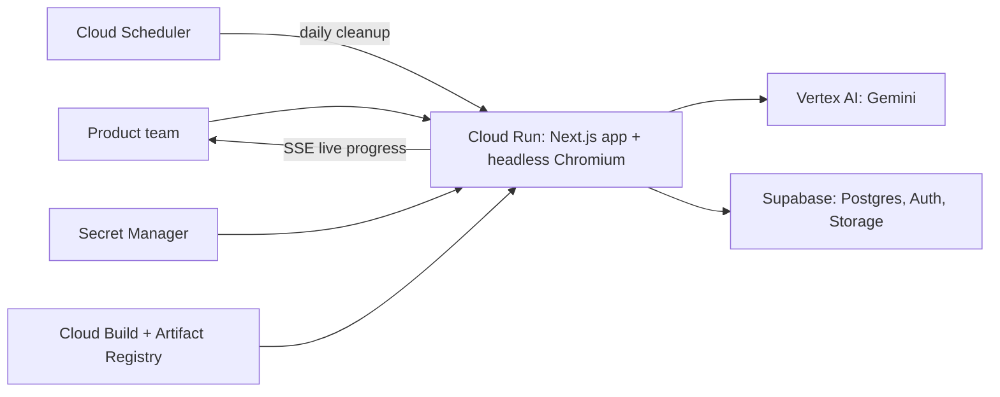

# Heuristiq

**UX research on autopilot.** Heuristiq sends Gemini-powered AI personas into a live web product. Each persona browses in its own real Chromium session, in parallel, behaving like a first-time visitor, an impatient expert, or a careful mobile shopper. Every hesitation becomes a prioritized, evidence-backed usability finding, with video, step screenshots, and suggested fixes, in minutes instead of weeks.

- **Live app:** `https://heuristiq-xnlfddpy3a-as.a.run.app/`
- **Demo video:** `https://www.youtube.com/watch?v=x05Q1cMyYQw`

## Evaluating in 5 minutes

1. Open the live app and click **Try the Demo** to create an account.
2. The dashboard shows a **Start here** card. Every new account is seeded with a draft study: three personas (first-time desktop user, power user, price-sensitive mobile shopper) logging in, comparing products, and checking out on [saucedemo.com](https://www.saucedemo.com), a public store built for automation testing.
3. Click **Review & launch demo**, then **Launch Experiment**.
4. Watch the agent console. All three runs stream screenshots, reasoning, and actions live.
5. When the runs finish (about 3 to 5 minutes), open the report. It includes an executive summary, severity-ranked findings combined across personas, and each persona's journey with session video and a step-by-step screenshot timeline. The experiment page shows how many Gemini calls and tokens the study used, and what it cost.

Then try it on your own product: **Usability Experiment**, then enter a URL, a plain-English task, and pick personas.

## What makes it different

| | Traditional usability study | Heuristiq |
|---|---|---|
| Participants | Recruit and schedule | Configurable AI personas (device, expertise, patience, background) |
| Environment | Lab or remote session | Real Chromium on your live site, desktop and mobile viewports |
| Turnaround | Days to weeks | Minutes, all personas in parallel |
| Analysis | Manual review of recordings | Gemini synthesizes findings with severity, frequency, and fixes |
| Evidence | Notes | Video, per-step screenshots, checkpoint tracking |

## How it works



Each persona run is an agent loop of up to 20 steps in an isolated browser context:

1. **Observe.** Playwright captures a screenshot and a compact map of the page's interactive elements (`src/lib/browser-automation.ts`).
2. **Think.** Gemini receives both, plus the persona profile, task script, checkpoint status, and recent actions, and returns a structured decision: the action, target, reasoning, confidence, task progress, and a UX observation (`src/lib/ai/browser-agent.ts`, `src/lib/ai/prompts/`).
3. **Act.** A resilient executor performs it, with 10+ fallback locator strategies, modal and overlay dismissal, and retries. Automation failures are kept separate from genuine UX issues.
4. **Track.** Progress is matched against checkpoints parsed from the task script (`src/lib/task-tracking.ts`).

After each run, Gemini turns the collected observations into insights and recommendations (`src/lib/ai/run-analysis.ts`). After all runs, it merges them into deduplicated findings ranked by severity and frequency (`src/lib/ai/aggregation.ts`). Runs execute concurrently, and their progress is multiplexed over a single server-sent events stream (`src/lib/sse-multiplexer.ts`, `src/app/api/experiments/run-parallel/route.ts`). Every Gemini call is metered for tokens and cost (`src/lib/ai/llm-usage.ts`).

For a deeper walkthrough, see [docs/technical-architecture-report.md](docs/technical-architecture-report.md).

## Google Cloud services

| Service | Role |
|---|---|
| Cloud Run (gen2) | Hosts the Next.js app **and** Chromium in one container image. Session affinity and a 60-minute request timeout keep long-lived SSE runs on one instance. |
| Vertex AI (Gemini, default `gemini-3-flash-preview`) | Multimodal navigation decisions, per-run analysis, cross-persona aggregation. Authenticated with the Cloud Run service account, so no API key is needed. |
| Cloud Build + Artifact Registry | Builds and stores the container image (`deploy/cloudbuild.yaml`). |
| Secret Manager | Supabase service-role key, cron secret, optional Resend key. |
| Cloud Scheduler | Calls `/api/cron/cleanup-recordings` daily to delete expired session videos. |

## Benchmarks

Navigation reliability is measured with a 10-task suite on live public websites (`src/lib/benchmarking/`, task design in [docs/benchmarking-navigation-tasks.md](docs/benchmarking-navigation-tasks.md)). A separate Gemini judge checks each task step against the agent's recorded trajectory, not its own claims. A run passes only if it reaches the expected final URL, visits every required page, and completes enough checkpoints, with no failures or forbidden actions.

Full run, 10 tasks × 3 runs, Gemini 3.8 Flash ([benchmark-results/2026-10-18T10-48-50.json](benchmark-results/2026-10-18T10-48-50.json)):

| Metric | Result |
|---|---|
| Navigation reliability score | 85 / 100 |
| Checkpoints completed | 86% |
| Pass / partial / fail | 67% / 7% / 27% |
| Fatal errors | 0 |
| Average Gemini cost per run (including thinking tokens) | $0.041 |

| Task | Difficulty | Passed | Checkpoints |
|---|---|---|---|
| T01 Wikipedia article discovery | Easy | 3/3 | 100% |
| T02 Hacker News story deep-dive | Easy | 3/3 | 100% |
| T03 GitHub repository exploration | Medium | 0/3 | 57% |
| T04 MDN API reference lookup | Medium | 1/3 | 67% |
| T05 Open Library search to author page (mobile) | Medium | 2/3 | 75% |
| T06 Stripe marketing exploration | Medium | 3/3 | 100% |
| T07 TodoMVC CRUD flow | Medium | 3/3 | 100% |
| T08 SauceDemo login to checkout | Hard | 3/3 | 100% |
| T09 Atom habit tracker journey (mobile) | Hard | 0/3 | 87% |
| T10 Heuristiq landing page tour (mobile) | Easy | 2/3 | 75% |

Run it yourself (needs a Gemini credential in `.env.local`; Supabase is optional for benchmarks):

```bash
npm run benchmark:smoke                 # T01 once
npm run benchmark -- --reps 3           # all 10 tasks x 3, one run at a time
npm run benchmark -- --reps 3 --parallel  # each task's 3 runs at the same time
npm run benchmark -- --tasks T08,T09 --reps 1
```

## Repository layout

```
src/
  app/                 Next.js App Router pages and API routes
    api/experiments/   Parallel run orchestration (SSE), recovery, re-aggregation
    api/ai/            Single-run browser analysis and aggregation endpoints
  components/          UI (dashboard, experiment wizard, live console, reports, landing)
  lib/
    browser-automation.ts   Chromium pool, DOM extraction, resilient action executor
    ai/                     Gemini client, prompts, navigation, analysis, aggregation
    benchmarking/           Task suite, runner, verifier, LLM judge
supabase/migrations/   Database schema, seed triggers, demo experiment (009), storage (010)
scripts/               Benchmark CLI
benchmark-results/     Committed benchmark runs
deploy/                Cloud Build config and Cloud Run deploy script
Dockerfile             Two-stage build on the official Playwright image
```

## Setup

### 1. Supabase

1. Create a Supabase project.
2. In the SQL editor, run every file in `supabase/migrations/` in order (001 to 010). Migration 009 seeds the demo study for each new account. To add it for users who already exist:
   ```sql
   SELECT public.create_demo_experiment(id) FROM public.profiles;
   ```
3. Migration 010 creates the two public storage buckets (`experiment-screenshots`, `experiment-recordings`) and their upload policies. Check that both appear under **Storage**.
4. To let reviewers sign up without email verification, turn off **Authentication > Providers > Email > Confirm email**. Signup then goes straight to the dashboard.
5. After deploying, add the app URL under **Authentication > URL Configuration**.

### 2. Local development

```bash
cp .env.example .env.local   # fill in Supabase and one Gemini credential
npm install                  # also installs Playwright Chromium
npm run dev
```

### 3. Deploy to Cloud Run

Prerequisites: the `gcloud` CLI, logged in to a project with billing enabled.

```bash
cp deploy/.env.deploy.example deploy/.env.deploy   # fill in values
./deploy/deploy.sh
```

The script is idempotent. It:

1. Enables the required APIs.
2. Creates an Artifact Registry repository and a least-privilege runtime service account (`aiplatform.user`, `secretmanager.secretAccessor`, `logging.logWriter`).
3. Stores secrets in Secret Manager.
4. Builds the image with Cloud Build.
5. Deploys to Cloud Run with 4 vCPU, 8 GiB, a 3600 s timeout, and session affinity. The default region is `asia-southeast1`.
6. Sets `APP_URL` and schedules the daily cleanup job.

Keep `MIN_INSTANCES=1` while the app is being evaluated to avoid cold starts, and set it back to 0 afterwards.

To run the production image locally:

```bash
docker build -t heuristiq \
  --build-arg NEXT_PUBLIC_SUPABASE_URL=... \
  --build-arg NEXT_PUBLIC_SUPABASE_ANON_KEY=... .
docker run -p 8080:8080 --env-file .env.local heuristiq
```

## Configuration

| Variable | Required | Notes |
|---|---|---|
| `NEXT_PUBLIC_SUPABASE_URL`, `NEXT_PUBLIC_SUPABASE_ANON_KEY` | Yes | Inlined at build time (Docker build args). |
| `SUPABASE_SERVICE_ROLE_KEY` | Yes | Server-side uploads of screenshots and recordings. |
| `GOOGLE_CLOUD_PROJECT` (+ `GOOGLE_CLOUD_LOCATION`, default `global`) | One Gemini credential | Vertex AI with Application Default Credentials. Used on Cloud Run. |
| `GOOGLE_VERTEX_API_KEY` | | Vertex AI Express mode. |
| `GOOGLE_GEMINI_API_KEY` | | AI Studio, for local development. |
| `GEMINI_MODEL`, `GEMINI_VISION_MODEL` | No | Default `gemini-3-flash-preview`. |
| `MAX_BROWSER_CONTEXTS` | No | Concurrent Chromium contexts per instance (default 15; deploy script sets 12). |
| `APP_URL` | No | Public URL used in emails. |
| `CRON_SECRET` | No | Bearer token for the cleanup endpoint. |
| `RESEND_API_KEY`, `RESEND_FROM_EMAIL` | No | Experiment-completed emails. |

## Tech stack

Next.js 16 (App Router), React 19, TypeScript, Tailwind CSS 4, shadcn/ui, Zustand, Playwright, `@google/genai`, Supabase.
